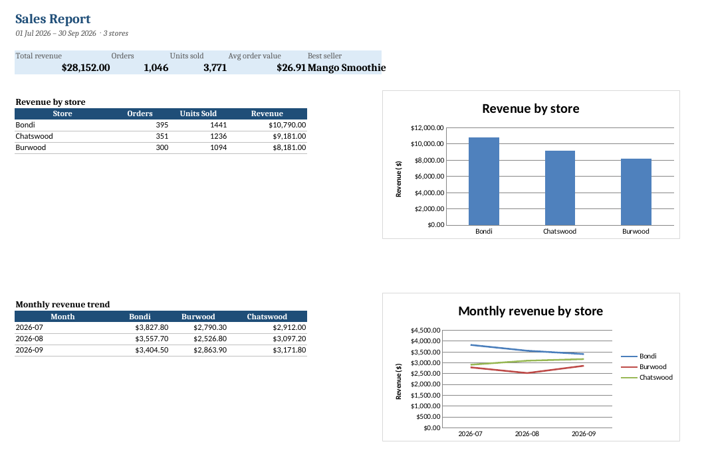

# Sales Report Automation

Turn messy sales exports from multiple stores into one clean Excel report, in one command.

Small businesses often get sales data from different POS systems, staff spreadsheets and branches, each in a different format. Combining them by hand every week is slow and error-prone. This tool does it automatically.



## What it does

**Reads files in any of these shapes:**

- CSV and Excel (`.csv`, `.xlsx`, `.xls`)
- Different column names for the same thing (`Qty`, `quantity`, `Units` …), matched case-insensitively
- Different date formats: `2026-09-01`, `2026/09/01`, Australian `01/09/2026`
- Prices with `$` signs and thousands separators

**Cleans the data:**

- Removes duplicate rows from repeated exports (using the order/receipt number when the file has one)
- Drops incomplete rows (missing date, product, quantity or price)
- Fixes inconsistent product names (`  matcha LATTE ` → `Matcha Latte`)
- Keeps refunds (negative quantities) so revenue is accurate

**Produces a formatted Excel report:**

| Sheet | Contents |
|---|---|
| Summary | Key figures (revenue, orders, units, average order value, best seller), revenue by store, monthly trend, with charts |
| By Product | Units and revenue per product, ranked, with chart |
| Clean Data | Every cleaned row, with filters, ready for further analysis |
| Data Quality Log | What was fixed in each file, so results can be checked |

Charts are native Excel charts, so they stay editable.

## Quick start

Requires Python 3.10+.

```bash
git clone https://github.com/Changyu-Han/sales-report-automation.git
cd sales-report-automation
pip install -r requirements.txt

python scripts/generate_sample_data.py   # create demo data in data/raw/
python -m sales_report                   # build the report in output/
```

To use your own data, put your CSV/Excel files in a folder and run:

```bash
python -m sales_report --input path/to/your/files --output report.xlsx
```

The store name is taken from the end of each file name, e.g. `store_b_chatswood.xlsx` → `Chatswood`.

## Adapting to new files

If a file uses a column name the tool doesn't recognise, it stops with a clear message listing the columns it found. Add the new name to `COLUMN_ALIASES` in `sales_report/cleaner.py` and run again.

## Running tests

```bash
pip install -r requirements-dev.txt
pytest
```

## Project structure

```
sales_report/
  cleaner.py      # loading, column matching, cleaning, de-duplication
  report.py       # summaries and Excel output with charts
  __main__.py     # command-line interface
scripts/
  generate_sample_data.py   # realistic messy demo data
tests/            # unit and end-to-end tests
```

## Need something similar?

I build small automation tools like this: report generation, data cleaning, spreadsheet workflows and web scraping. Feel free to get in touch through GitHub.
